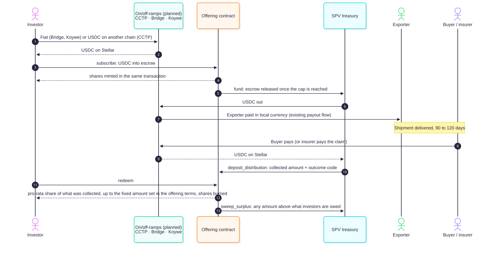
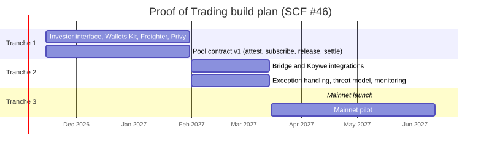

# Proof of Trading

Agri-export trade receivables, financed through **one pool share, TRU3**, on Stellar, with a verifiable record (attestation) for every receivable. Investors fund **trade receivables**; there is no lending or borrowing. **Testnet:** the v0.2 per-shipment prototype; the pool contract is the Tranche 1 build.



- **Repository:** https://github.com/AgroSmart-Contracts/Proof-Of-Trading
- **Demo app:** https://proof-of-trading.vercel.app
- **Pilot design:** [pool contract v1](docs/pool-contract-v1.md) · [integrations](docs/integrations.md)
- **Hackathon record (HackMeridian, Oct 2026):** [`docs/hackathon-overview.md`](docs/hackathon-overview.md)

## The problem
TruMarket finances agri-export shipments, mostly from Peru: **287 deals since June 2024, USD 18.8M of goods shipped, USD 10.3M financing advanced; 2 defaults in 2024, none since** (tape of record, 3 Oct 2026). Exporters wait 90 to 120 days to be paid. Their receivables are hard to fund from outside investors, and the customs records that prove them can't be made public. Proof of Trading puts a private, verifiable record of each receivable on Stellar, and funds the receivables through one pool that approved investors can buy into.

## The pilot: one pool share (TRU3), an attestation per receivable
- **Pool share.** The receivables-portfolio SPV issues one share asset, **TRU3** (1 TRU3 = USD 1), AUTH_REQUIRED, AUTH_REVOCABLE and AUTH_CLAWBACK_ENABLED, with the pool contract as SAC admin. Investors subscribe in Circle USDC and shares are minted in the same transaction.
- **Investors.** Legal entities only, after KYB, minimum ticket USD 50,000. No natural persons, no US persons.
- **Receivables.** Each one is attested under its export declaration no., invoice no. and buyer tax ID, and can't be attested twice. Its status (paid, overdue, claim, loss, revoked) is appended, never edited.
- **Money.** 90% of face is advanced to the exporter; the buyer's payment is applied as principal, then the investor amount fixed in the subscription agreement, then the balance (exporter's retained 10% and the TruMarket fee). Monthly distributions; redemption at NAV at the 3-month term.
- **Credit insurance** to be bound and endorsed, with the vehicle named on the policy, before the first pool receivable.
- **Rails.** Circle USDC on Stellar is the USD rail. Bridge turns the buyer's USD into USDC; Koywe pays exporters in PEN or CLP. Nothing is bridged.
- **Integrations:** Stellar Wallets Kit, Varial (formerly Freighter), Privy, Bridge and Koywe.

Design: [`docs/pool-contract-v1.md`](docs/pool-contract-v1.md) · integrations: [`docs/integrations.md`](docs/integrations.md) · decision: [ADR 0001](docs/adr/0001-share-asset-structure.md)



## Deployments
Everything deployed on testnet (v0.3 on Circle testnet USDC, and the v0.2 per-shipment prototype on TUSDC), with what each artifact proves and an explorer link: **[`docs/DEPLOYMENTS.md`](docs/DEPLOYMENTS.md)**.

| Check (5 to 6 Nov 2026) | Result |
|---|---|
| Contracts exist on testnet | **15/15** (12 v0.2, 3 v0.3) |
| Accounts exist on testnet | **9/9** |
| Transactions confirmed | **101/101** (72 v0.2, 29 v0.3) |
| `npm run verify` | **20/20 PASS** |

- **Offering contract (v0.3, Circle testnet USDC):** [`CAYNSQPZFYTH3WYW5SNKYXAQI7NL7SKLUDMJGQSRCFISUT3MUOFEMQ3B`](https://stellar.expert/explorer/testnet/contract/CAYNSQPZFYTH3WYW5SNKYXAQI7NL7SKLUDMJGQSRCFISUT3MUOFEMQ3B): SHP-0280 ran subscribe, fund, buyer payment, redeem and the outcome record in storage ([DEPLOYMENTS.md](docs/DEPLOYMENTS.md#v03-circle-testnet-usdc)).

- **Offering contract (v0.2):** [`CDY4E5QNPU4GEAQG6RI526DSUK3TTRI6ONGWVTBKUZQY5XTZFF3BFVK7`](https://stellar.expert/explorer/testnet/contract/CDY4E5QNPU4GEAQG6RI526DSUK3TTRI6ONGWVTBKUZQY5XTZFF3BFVK7)
- **Key transactions (SHP-0247):**
  - [Shipment proof hash recorded on-chain](https://stellar.expert/explorer/testnet/tx/88cfe725eb57da4d3d37c663e959e3b84d18e3448434d738d16e7ca763d84aad)
  - [Investor subscribes 60,000 TUSDC, contract mints 60,000 shares](https://stellar.expert/explorer/testnet/tx/e7ea02bb2f8d66883694cc8c0fa2834a64fb803907518224bd1968409afdae99)
  - [Investor paid the investor amount fixed in the subscription agreement, shares burned](https://stellar.expert/explorer/testnet/tx/fbfcc98464208dc18a2aa0f2ff2aef817f1949f4a8dc65d954be9aa510f900bc)

The v0.2 IDs don't change. The v0.3 contract is recorded separately as `offering_v3`. The pool contract is not deployed yet.

## How to verify a v0.2 offering
No keys or local records needed. For SHP-0247 (offering 247):

```sh
# 1. The proof hash the offering contract keeps in storage
stellar contract invoke --network testnet --send=no \
  --id CDY4E5QNPU4GEAQG6RI526DSUK3TTRI6ONGWVTBKUZQY5XTZFF3BFVK7 \
  --source-account GCGN654QTVW22WCIUFF3CSGHHHPQQ2L4AG7LQHUZQ4FKB4BWSF4R3W3F \
  -- get_offering --id 247 | jq -r .p.proof_hash

# 2. The same hash in the attestation transaction's MEMO_HASH (Horizon keeps it beyond RPC's ~7 days)
curl -s https://horizon-testnet.stellar.org/transactions/88cfe725eb57da4d3d37c663e959e3b84d18e3448434d738d16e7ca763d84aad \
  | jq -r .memo | base64 -d | xxd -p -c 32

# Both print 64901e64eed610c58f0c731182de00fa1093c0c5158e5aa5b7c41428e3e63d74.
# With the local records (data/store), recompute every hash from its payload and check it on-chain:
npm run verify -- SHP-0247
```

`--send=no` only simulates, so the source account needs no secret. On the v0.3 contract, `get_record --id <n>` gives the outcome record (hash and `Repaid`, `InsuredLoss` or `Refunded`).

## Scope
**In scope (pilot)**
- One pool share, TRU3, issued by the receivables-portfolio SPV and held only by approved legal entities ([ADR 0001](docs/adr/0001-share-asset-structure.md)).
- One attestation per receivable in the pool contract, with an append-only status history.
- Subscription in Circle USDC, release of 90% of face per attested receivable, settlement through the waterfall, monthly distributions, redemption at NAV.
- Buyer collections through Bridge and exporter payouts through Koywe.

**Out of scope for this grant**
- One instrument per receivable (the v0.2 prototype's model).
- Secondary trading of TRU3 (see the [SEP-57 / SEP-8 note](docs/spikes/sep57-sep8.md)).
- Natural persons and US persons.
- Using the shares as collateral.

**Post-grant:** TRU3 transfers between approved holders, and use of TRU3 in isolated lending pools (for example Blend) open to approved holders only.

## Security model
- **Who can do what** is enforced in the contract and tested (auth-matrix tests): the admin runs the offering lifecycle, the SPV treasury alone deposits collections, investors alone subscribe, redeem and refund their own position, and the recorder alone writes outcome records, once each. Details: [`docs/governance.md`](docs/governance.md).
- **KYB gate in the protocol:** share assets have AUTH_REQUIRED, so an unapproved wallet's subscription is rejected by the asset itself as well as by the app.
- **No minting without payment:** the offering contract is the only minter (SAC admin), and it mints in the same transaction that takes the investor's USDC. Escrow is tracked per offering, and arithmetic is checked (`checked_*`, `overflow-checks = true`).
- **Freeze and clawback** (AUTH_REVOCABLE, AUTH_CLAWBACK_ENABLED) are limited by a written policy and need 2 of 3 issuer signers: [`docs/governance.md`](docs/governance.md).
- **Keys:** testnet keys sit in a gitignored `.env`. Before pilots, the issuer/admin and treasury move to a 2-of-3 multisig with the master key locked (`npm run governance:setup`, dry run by default).
- **Data:** only hashes, pseudonyms, balances and USDC movements are on-chain. Customs records, salts and identities stay with TruMarket.
- **Pilot additions** ([pool contract v1](docs/pool-contract-v1.md)): two-person approval for attestations, concentration limits checked on every release, a reason stored for every pause, freeze and clawback, and upgrades only with 2 of 3 signers and 30 days' notice.
- **Not yet done:** an external audit.

## Status
### v0.3 (SCF #46 review feedback)
- **Outcome records in contract storage.** The recorder writes each offering's outcome (`Repaid`, `InsuredLoss`, `Refunded`) and its proof hash once, with an `OutcomeRecorded` event. `verify` now checks contract storage first, then Horizon, then RPC: 20/20 PASS (7 from contract storage, 13 from Horizon).
- **Circle testnet USDC.** The settlement asset is fixed at deploy (constructor) and set by `SETTLEMENT_ASSET`; the default is Circle's testnet USDC. TUSDC stays for the v0.2 record.
- **`cargo test`: 25 offering tests and 2 spike tests pass, 1 pool test ignored** (27 passed, 1 ignored), with exact base-unit assertions (e.g. $100,000 at 12% for 120 days owes `1_039_452_054_794`). Key tests were checked by temporarily breaking the contract and confirming they fail.
- **Pool model:** [pool contract v1](docs/pool-contract-v1.md), [integrations](docs/integrations.md), pool figures, and the first Tranche 1 test, `duplicate_attestation_rejected`, written first and ignored until `attest` exists.
- **Docs:** [ADR 0001](docs/adr/0001-share-asset-structure.md), [figures](docs/figures), [rent and TTL](docs/rent-and-ttl.md) with a TTL keeper, [governance](docs/governance.md), a [SEP-1 `stellar.toml`](apps/dashboard/public/.well-known/stellar.toml) generator, and a [SEP-57 / SEP-8 note](docs/spikes/sep57-sep8.md).

### v0.2 (built at HackMeridian, Oct 25 to 26)
- **Offering contract** [`contracts/offering`](contracts/offering): one instance manages one offering per financed shipment. It is the **SAC admin** of each share asset, so it mints shares on `subscribe` and burns them on `redeem`/`refund`.
- **Payment rule (founders' decision):** each offering's terms set a fixed rate and term, giving a fixed amount owed: `owed = principal × (1 + rate × term / 365)`. Investors get `min(owed, collected)` pro rata. If the buyer pays in full, investors get the fixed amount and the surplus goes back to the SPV; if the insurer pays 90%, they share what was collected.
- **On testnet:** happy path (SHP-0247, SHP-0270), insured failure (SHP-0251) and under-subscribed refund (SHP-0258), and an unapproved wallet's subscription rejected by the asset itself (`BalanceDeauthorizedError`).
- **Dashboard:** offerings page, investor views ("You own 27,000 shares of TM0270 (60% of the SPV)"), per-shipment timeline.

### v0.1 (baseline, built before the event)
- **Proof layer:** 12 consented synthetic shipments attested on testnet with `MEMO_HASH`. 2 non-consented shipments are skipped by design.
- **Share assets:** one classic asset per financed shipment with AUTH_REQUIRED, AUTH_REVOCABLE and AUTH_CLAWBACK_ENABLED, a deployed SAC, and a link to the shipment's proof hash.
- **Spike: GO.** A Soroban contract can be the SAC admin: it authorizes, mints, is refused for an unapproved wallet, burns, and hands admin back. See [`docs/spike-report.md`](docs/spike-report.md).

## Architecture





How this fits into TruMarket today (planned; nothing in production uses Stellar yet):



Details: [`docs/architecture.md`](docs/architecture.md) · v0.2 payload format: [`docs/proof-schema-v1.md`](docs/proof-schema-v1.md) · figure sources: [`docs/figures`](docs/figures)

**Stellar components:** classic assets with authorization flags and clawback, Stellar Asset Contract, Soroban contracts (constructor, auth, persistent storage with TTL, events), sponsored reserves and fee-bump (Privy wallets), memo-hash attestations, Stellar RPC, with Horizon for history beyond the RPC retention window, SEP-1.

## Simulated vs real
| Real-world dependency | In this demo | Becomes real in |
|---|---|---|
| Vehicle legal structure | Testnet treasury account + share asset; legal structure under counsel review | Tranche 1 |
| Investor KYB / eligibility (legal entities, min. USD 50,000) | Admin approval stands in for KYB | Tranche 1 |
| Credit insurance, vehicle named on the policy | sha256 of a placeholder file | Bound and endorsed before the first pool receivable |
| Peruvian customs records, exporter consent | Synthetic files only | Tranches 1 and 2 |
| Arc deal data | Labelled stubs (`stub-<n>`); reads Arc testnet when `ARC_RPC_URL` is set | Tranche 2 |
| CRAM risk scores | Precomputed bands | Tranche 2 |
| USDC | Circle testnet USDC by default (v0.3); the v0.2 record used TUSDC, our test asset | Tranche 1 (mainnet USDC) |
| Pool contract | Designed; per-shipment v0.2 contract on testnet | Tranche 1 |
| Bridge, Koywe | Designed ([integrations](docs/integrations.md)) | Tranche 2 |
| Multisig, issuer lock, mainnet | Documented, setup script ready | Tranche 3 |
| Share collateral, secondary trading | Out of scope | Not planned |

## SCF #46 roadmap
One line per tranche. The plan, budget and deliverables are in the SCF #46 submission.
- **Tranche 1 (31/01/2027):** investor interface, wallets (Stellar Wallets Kit, Varial (formerly Freighter), Privy), pool contract v1.
- **Tranche 2 (15/03/2027):** Bridge, Koywe, exception handling, threat model and monitoring.
- **Tranche 3 (12/06/2027):** mainnet pilot, with launch by 10/04/2027.
- **Metric:** at least USD 250,000 in USDC from at least 3 independent institutional investor wallets within 60 days of mainnet launch.



## Setup
Requires Node 20+, Rust stable with `wasm32v1-none`, and the Stellar CLI.
```sh
npm install
npm run setup:accounts     # generates + friendbot-funds testnet accounts into .env (prints public keys only)
npm run setup:tusdc        # v0.2 record only: issues TUSDC, funds holders, deploys its SAC
npm run samples:check      # validates data/samples, flags non-consented shipments
npm run attest -- --dry-run
npm run attest             # one MEMO_HASH tx per consented shipment (idempotent; --only SHP-0247, --force)
npm run verify             # PASS/FAIL per record: contract storage, then Horizon, then RPC
npm run issue:shares       # share asset + SAC per financed shipment
npm test                   # core unit tests
(cd contracts && cargo test && stellar contract build)
(cd apps/dashboard && npm run dev)
```

Run the offering lifecycle:
```sh
npm run offering -- deploy        # deploys the v0.3 contract (SETTLEMENT_ASSET, default Circle testnet USDC)
npm run demo -- SHP-0247          # happy path: approve, unapproved rejected, subscribe 60/40, fund, buyer pays, redeem, sweep, outcome recorded
npm run demo:failure -- SHP-0251  # insurer pays 90% (outcome 4), pro-rata redemption
npm run demo:refund -- SHP-0258   # 5-minute offering, partial subscription, refund
npm run offering -- status SHP-0247
npm run ttl:keeper -- --days 120  # entry states and rent estimate (dry run)
npm run stellar-toml              # regenerates apps/dashboard/public/.well-known/stellar.toml
```
Investors need Circle testnet USDC from https://faucet.circle.com (Stellar testnet) to subscribe on the v0.3 contract. Each step prints an explorer link and is logged to `data/store/offerings.json`; `npm run offering` lists the subcommands.

`data/store/` (payloads with salts, tx records) and `.env` are gitignored. Never publish them.

**Testnet notes:** uploading the offering contract needs ~620 XLM of resource fee, above what a classic `u32` fee allows, so it is sent as a fee bump. Rent moves with how full testnet is: see [`docs/rent-and-ttl.md`](docs/rent-and-ttl.md).

## Prior work disclosure
The TruMarket platform (deal flow, Arc contracts, apps) is **prior work and is not submitted**. v0.1 code was built on **Sat Oct 24, 2026, before kickoff**, and is tagged `v0.1`. The v0.2 event work was committed on Mon Oct 26. See [`docs/prior-work.md`](docs/prior-work.md).

**AI assistance:** parts of the code, tests and documentation were written with an AI coding assistant (Claude Code) and reviewed by the team.

Not a retail product: legal entities only, minimum ticket USD 50,000, no natural persons or US persons. Shares are paid from what the pool collects, up to the investor amount fixed in the subscription agreement; they are not a promise of repayment.
