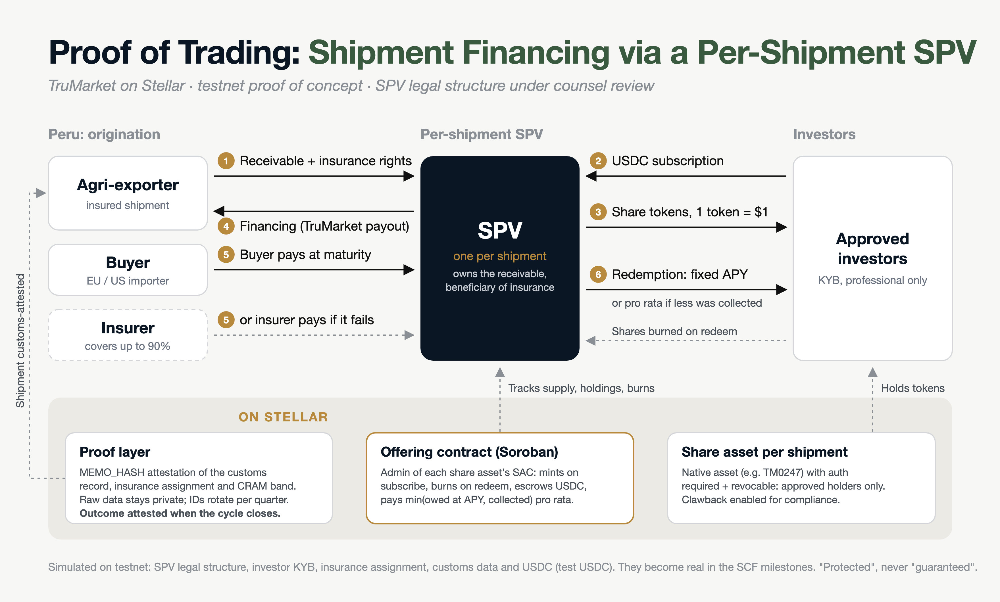
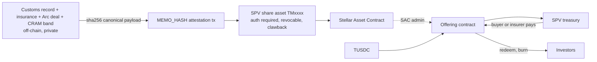

# Proof of Trading

Customs-attested agri-export shipments, financed through tokenized SPV shares on Stellar. **Testnet proof of concept.**



**Start here:** [`docs/hackathon-overview.md`](docs/hackathon-overview.md): what we built, testnet evidence, the investor app, the demo script and how this integrates into TruMarket.

## The problem
TruMarket finances insured agri-export shipments, mostly from Peru (~247 deals, ~$22M over 24 months). Exporters wait 90 to 120 days to be paid. The shipment contracts are real, insured receivables, but lenders don't accept them as collateral, and the customs records that prove them can't be made public. Proof of Trading puts a private, verifiable record of each shipment on Stellar, and turns each financed shipment into SPV shares that approved investors can fund.

## Status: v0.2 (built at HackMeridian, Oct 25 to 26)
- **Offering contract** [`contracts/offering`](contracts/offering): one instance manages one offering per financed shipment. It is the **SAC admin** of each share asset, so it mints shares on `subscribe` and burns them on `redeem`/`refund`. Testnet: `CDY4E5QNPU4GEAQG6RI526DSUK3TTRI6ONGWVTBKUZQY5XTZFF3BFVK7`.
- **Return rule (founders' decision):** fixed APY per deal. `owed = principal × (1 + APY × term / 365)`; investors get `min(owed, collected)` pro rata. If the buyer pays in full, investors get principal + APY and the surplus goes back to the SPV; if the insurer pays 90%, they share what was collected.
- **17 contract tests** (`cargo test`), with exact base-unit assertions (e.g. $100,000 at 12% for 120 days = `1_039_452_054_794`). Key tests were checked by temporarily breaking the contract and confirming they fail.
- **On testnet:**
  - Happy path (SHP-0270): two investors subscribe 60/40, shares minted, offering closes and funds the SPV, buyer pays, both redeem at the APY with shares burned, surplus swept, outcome attested.
  - An unapproved wallet's subscription is rejected by the asset itself (`BalanceDeauthorizedError`).
  - Insured failure (SHP-0251) and under-subscribed refund (SHP-0258) scripts: see [Run the demos](#run-the-demos).
- **Dashboard:** offerings page, investor views ("You own 27,000 shares of TM0270 (60% of the SPV)"), per-shipment timeline.

### Run the demos
```sh
npm run offering -- deploy        # once (already deployed on testnet; see data/store/contracts.json)
npm run demo -- SHP-0247          # happy path: approve, unapproved rejected, subscribe 60/40, fund, buyer pays, redeem, sweep, outcome attested
npm run demo:failure -- SHP-0251  # insurer pays 90% (outcome 4), pro-rata redemption
npm run demo:refund -- SHP-0258   # 5-minute offering, partial subscription, refund
npm run offering -- status SHP-0247
(cd apps/dashboard && npm run dev)
```
Each step prints an explorer link and is logged to `data/store/offerings.json`. Step by step: `npm run offering` lists the subcommands (`handover`, `create`, `trustlines`, `approve`, `subscribe`, `fund`, `distribute`, `redeem`, `sweep`, `attest-outcome`, `start-refunds`, `refund`, `hand-back`).

### Testnet notes (worth knowing)
- **Contract upload fees are priced on the parsed module, not its bytes.** Uploading the offering contract needs ~620 XLM of resource fee, above the ~429 XLM a classic `u32` fee allows. `submitSoroban` sends it as a **fee bump** (`i64` fee).
- **Rent dominates.** Testnet state is above its target size, so rent is high: extending one offering record to 120 days cost ~10,000 XLM. The contract keeps entries at the network minimum (~7 days) for the demo; production must extend to the deal term. `npm run topup` refills an account from friendbot.

## Status: v0.1 (baseline, built before the event)
- **Proof layer:** 12 consented synthetic shipments attested on testnet with `MEMO_HASH`; `npm run verify` gives 12/12 PASS. 2 non-consented shipments are skipped by design.
- **Share assets:** one classic asset per financed shipment (`TM0247`, `TM0251`, `TM0258`, `TM0263`, `TM0270`) with AUTH_REQUIRED, AUTH_REVOCABLE and AUTH_CLAWBACK_ENABLED, a deployed SAC, and a link to the shipment's proof hash.
- **Spike: GO.** A Soroban contract can be the SAC admin: it authorizes, mints, is refused for an unapproved wallet, burns, and hands admin back. See [`docs/spike-report.md`](docs/spike-report.md).
- **TUSDC:** our own **test USDC** on testnet (not Circle USDC), SAC `CC3GZE5HDQGVXAMGRSERDGQPQUQH64ZVRMXUZ7KQZ6M5DUVF2WTVT2D6`.
- **Dashboard:** read-only list of attestations and share assets, with explorer links.

## Architecture

Details: [`docs/architecture.md`](docs/architecture.md) · payload format: [`docs/proof-schema-v1.md`](docs/proof-schema-v1.md)

**Stellar components:** classic assets with authorization flags and clawback, Stellar Asset Contract, Soroban contracts, memo-hash attestations, Stellar RPC (no Horizon).

## Simulated vs real
| Real-world dependency | In this demo | Becomes real in |
|---|---|---|
| SPV legal structure, securities basis | Testnet treasury account + share asset; legal structure under counsel review | SCF M1 |
| Investor KYB / eligibility | Admin approval stands in for KYB | SCF M1 |
| Insurance assignment to the SPV | sha256 of a placeholder file | SCF M1 |
| Peruvian customs records, exporter consent | Synthetic files only | SCF M1/M2 |
| Arc deal data | Labelled stubs (`stub-<n>`); reads Arc testnet when `ARC_RPC_URL` is set | SCF M2 |
| CRAM risk scores | Precomputed bands | SCF M2 |
| USDC | TUSDC, our test asset | SCF M1 |
| Audit, multisig, issuer lock, mainnet | Documented only | SCF M1 |
| Price feed, Blend, vault, collateral listing | Roadmap only | SCF M2/M3 |

## Setup
Requires Node 20+, Rust stable with `wasm32v1-none`, and the Stellar CLI.
```sh
npm install
npm run setup:accounts     # generates + friendbot-funds testnet accounts into .env (prints public keys only)
npm run setup:tusdc        # issues TUSDC, funds holders, deploys its SAC
npm run samples:check      # validates data/samples, flags non-consented shipments
npm run attest -- --dry-run
npm run attest             # one MEMO_HASH tx per consented shipment (idempotent; --only SHP-0247, --force)
npm run verify             # PASS/FAIL per record (envelope + live tx while in RPC retention)
npm run issue:shares       # share asset + SAC per financed shipment
npx tsx scripts/spike.ts   # SAC admin spike on a throwaway asset
npm test                   # core unit tests
npm run demo -- SHP-0247   # v0.2 happy path (see above)
(cd contracts && cargo test && stellar contract build)
(cd apps/dashboard && npm run dev)
```
`data/store/` (payloads with salts, tx records) and `.env` are gitignored. Never publish them.

## Prior work disclosure
The TruMarket platform (deal flow, Arc/Base contracts, Lagoon vault, apps) is **prior work and is not submitted**. v0.1 code was built on **Sat Oct 24, 2026, before kickoff**, and is tagged `v0.1`. Everything after that tag is event work (v0.2); this README and the `docs/` files were first drafted Sat night and extended during the event, and everything after `v0.1` was committed on Mon Oct 26. See [`docs/prior-work.md`](docs/prior-work.md).

Not a retail product. Shares are "protected" by the SPV's ownership of the receivable and its insurance (up to 90% cover, with exclusions), never "guaranteed".
