# Architecture

## Two layers on Stellar
**Proof layer (v0.1).** Every consented shipment, financed or not, gets one attestation: a `MEMO_HASH` classic payment from TruMarket's attestor account to a sink account. The memo is the sha256 of a canonical payload (see `proof-schema-v1.md`). Classic transactions are used because contract invocations cannot carry memos. An attestation registry contract is planned for SCF M1.

**Finance layer (v0.1 assets, v0.2 contract).** Each financed shipment has an SPV. Its shares are a per-shipment classic Stellar asset (`TM` + 4 digits, 1 token = 1 share = $1) with AUTH_REQUIRED, AUTH_REVOCABLE and AUTH_CLAWBACK_ENABLED, exposed through its Stellar Asset Contract (SAC). In v0.2 a Soroban offering contract becomes the SAC admin. Investors subscribe in USDC (TUSDC on testnet) and shares are minted automatically. When the buyer or the insurer pays the SPV, investors redeem and their shares are burned.

```mermaid
flowchart LR
  subgraph TruMarket off-chain
    C[Customs record<br/>synthetic in demo] --> P[Canonical payload<br/>+ salt + pseudonyms]
    I[Insurance assignment] --> P
    A[Arc DealsManager<br/>deal id] --> P
    R[CRAM band] --> P
    P --> S[(Store: payload, salt,<br/>tx, envelope XDR)]
  end
  P -- sha256 --> M[MEMO_HASH tx<br/>attestor → sink]
  M --> SH[Share asset TMxxxx<br/>AUTH_REQUIRED/REVOCABLE/CLAWBACK]
  SH --> SAC[SAC]
  SAC -. v0.2 admin .-> O[Offering contract]
  U[TUSDC] --> O
  O --> T[SPV treasury]
```

## On-chain vs off-chain
| On-chain (public) | Off-chain (TruMarket only) |
|---|---|
| 32-byte proof hash in a memo | Payload, salt, pseudonym secret |
| Share asset, flags, SAC, balances | Raw customs records, insurance documents |
| Attestor and issuer public keys | Exporter/buyer identities, KYB files |

The dashboard reads only `apps/dashboard/public/public-store.json`, which `scripts/export-public.ts` builds with the salt removed. The export refuses to write if a salt leaks.

## Accounts (testnet)
`issuer` (share assets; acts as TruMarket ops in the demo), `spv_treasury`, `investor_a`, `investor_b`, `unapproved`, `attestor`, `attestation_sink`, `tusdc_issuer`. Secrets live only in `.env` (gitignored).

## Mainnet hardening (documented only; SCF M1)
1. Create the share asset and set AUTH_REQUIRED, AUTH_REVOCABLE and AUTH_CLAWBACK_ENABLED **before** any trustline, so clawback applies to every balance.
2. Deploy the SAC.
3. **Hand the SAC admin to the audited offering contract first** (`set_admin`). The spike proved a contract admin can hand the role back (`hand_over`); the production contract keeps an equivalent admin-gated migration path.
4. **Then lock the issuer**: set master weight 0 (or move it to a multisig with no single-key control), so no one can mint outside the contract.
5. Ops, treasury and contract-admin keys go behind multisig (classic thresholds, later smart accounts).
6. Clawback is reserved for compliance (court orders, lost keys under counsel's process). Normal redemptions burn investor-authorized shares.

v0.1 deliberately does **not** lock the issuer or hand over SAC admin, so testnet stays recoverable.

## Offering contract (v0.2)
`contracts/offering`, deployed on testnet as `CDY4E5QNPU4GEAQG6RI526DSUK3TTRI6ONGWVTBKUZQY5XTZFF3BFVK7`. One instance, one offering per financed shipment (id = shipment number). The contract is the **SAC admin** of each share asset; `transfer_share_admin` hands that role back (to the issuer, or a successor contract).

```mermaid
stateDiagram-v2
  [*] --> Open: create_offering (admin; contract must be SAC admin)
  Open --> Open: subscribe (TUSDC in, shares minted)
  Open --> Closed: subscribe reaches cap
  Open --> Refunding: start_refunds (deadline passed, under cap)
  Refunding --> Refunding: refund (shares burned, TUSDC back)
  Closed --> Funded: fund (escrow → SPV treasury)
  Funded --> Distributing: deposit_distribution (treasury: buyer or insurer payment + outcome)
  Distributing --> Distributing: redeem (pay min(owed at APY, collected) pro rata, burn) / sweep_surplus
```



### Auth model
| Who | Calls |
|---|---|
| Admin (TruMarket ops; the issuer account on testnet) | `create_offering`, `approve_investor` (stands in for KYB), `fund`, `start_refunds`, `sweep_surplus`, `transfer_share_admin` |
| SPV treasury (stored per offering) | `deposit_distribution` |
| Investor | `subscribe`, `refund`, `redeem` (investor-authorized burns; clawback is never used for redemptions) |

An unapproved wallet can't subscribe: the SAC refuses to mint to an unauthorized trustline (`BalanceDeauthorizedError`), and the whole transaction reverts, including the TUSDC transfer.

### Money rules
- `shares = usdc × 10^7 / unit_price` (1 share = $1 → 1:1); amounts in 7-decimal base units, `i128`, checked arithmetic.
- `owed_total = principal + principal × apy_bps × term_secs / (10_000 × 31_536_000)`.
- `payout = shares × min(owed_total, collected) / shares_at_close` (round down; dust is swept).
- `fund` moves only that offering's escrow; the contract holds several offerings' escrow at once.

### Events
Topic = event name + offering id: `created`, `approved`, `subscribed` (with the subscription-agreement hash), `closed`, `funded`, `refunds`, `refunded`, `distribution` (amount, outcome), `redeemed` (shares, payout), `swept`.

### Closing the loop with the proof layer
After redemptions, `attest-outcome` publishes an `outcome` attestation: outcome code, amounts collected and owed, and the sha256 of the SPV's redemption confirmation (a placeholder on testnet).

### Storage and rent
Offerings and redemption flags are persistent entries. Testnet rent is currently very high (state above target size), so the contract keeps them at the network minimum TTL (~7 days) and tops up when under ~1 day. Production must keep them alive for the whole deal term (funding to maturity, 90 to 120 days) via TTL extension by a keeper.

## SCF path (beyond the hackathon)
1. **M1:** legal structure (SPV per shipment or compartments), securities basis, real insurance assignment, investor KYB behind `approve_investor`, audit of the offering contract and issuance controls, multisig admin/treasury, issuer lock on mainnet, attestation registry contract.
2. **M2:** pilot offerings with independent professional investors under a cap; real USDC; investor reporting; price feed (e.g. a SEP-40 oracle) and a Blend isolated-pool listing so share tokens can back loans.
3. **M3:** full lifecycle on record including an insured failure if one occurs; optional pool or vault token holding many shipment tokens.
