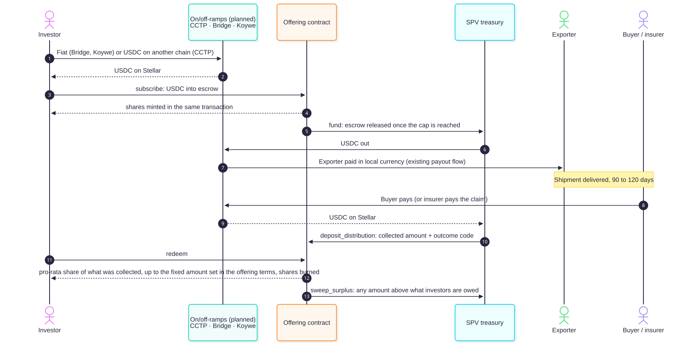
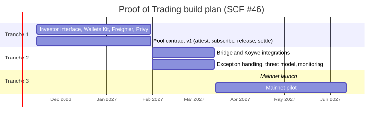

# Architecture

The pilot uses **one pool share with an attestation per receivable**. The contract on testnet is the **v0.2 per-shipment prototype**, kept as the record of what was built and tested; its design is below the pilot sections. Decision: [ADR 0001](adr/0001-share-asset-structure.md).

## Figures
- [System overview](figures/system.svg) and [pilot structure](figures/pilot-structure.svg)
- [Money flow for one receivable](figures/money-flow.svg) and [payment waterfall](figures/waterfall.svg)
- [Receivable lifecycle](figures/receivable-lifecycle.svg)
- [TruMarket before and after](figures/integration-before-after.svg) and [build plan](figures/build-plan.svg)
- v0.2 prototype: [offering lifecycle](figures/offering-lifecycle.svg)



## Pilot model (design, Tranche 1)
- **Vehicle and pool share.** One vehicle issues one pool share (1 share = USD 1) with AUTH_REQUIRED, AUTH_REVOCABLE and AUTH_CLAWBACK_ENABLED. The pool contract is its SAC admin, so shares are minted only against USDC paid in, in the same transaction.
- **Investors.** Legal entities only, after KYB, with a minimum ticket of USD 50,000. No natural persons and no US persons.
- **Receivables.** TruMarket screens each export receivable off-chain, then attests it in the pool contract under `sha256(export declaration no. | invoice no. | buyer tax ID)`. A key can be attested once. Its status history (paid, overdue, claim, loss, revoked) is appended, never edited.
- **Money.** `release` advances 90% of face to the payout account; `settle` applies the buyer's payment through the waterfall (principal, then the investor amount fixed in the subscription agreement, then the balance); `distribute` pays holders monthly; `redeem` pays NAV at the 3-month term.
- **Losses.** Quality claims fall on the exporter's retained 10%, then the TruMarket fee, then the pool. Buyer default falls on credit insurance (70 to 90%), then a 1% TruMarket reserve, then holders pro rata through NAV. Credit insurance is to be bound and endorsed, with the vehicle named on the policy, before the first pool receivable.
- **Limits.** 20% per receivable, 25% per buyer, 30% per exporter, 50% per product.

Interface, storage, events and governance: [pool-contract-v1.md](pool-contract-v1.md).



### Rails and integrations
Circle USDC on Stellar is the pilot's USD rail. Nothing is bridged.

| Building block | Role |
|---|---|
| Stellar Wallets Kit | One wallet picker for the investor interface |
| Freighter Connect | Browser wallet for investors who hold their own keys |
| Privy | Embedded wallets for investor staff, with sponsored reserves and fee-bump |
| Bridge | A USD virtual account per buyer; the buyer's USD arrives as USDC on Stellar |
| Koywe | Pays exporters: USDC to PEN or CLP |

Flows, signing, webhooks and reconciliation: [integrations.md](integrations.md).




## v0.2 prototype (testnet record)
The rest of this document describes what is deployed on testnet: one offering and one share asset per shipment, settled in TUSDC. It is unchanged so the [deployment record](DEPLOYMENTS.md) stays checkable.

### Two layers on Stellar
**Proof layer (v0.1).** Every consented shipment, financed or not, gets one attestation: a `MEMO_HASH` classic payment from TruMarket's attestor account to a sink account. The memo is the sha256 of a canonical payload (see `proof-schema-v1.md`). Classic transactions are used because contract invocations cannot carry memos. In the pilot, attestations move into the pool contract (`attest`).

**Finance layer (v0.1 assets, v0.2 contract).** Each financed shipment has an SPV. Its shares are a per-shipment classic Stellar asset (`TM` + 4 digits, 1 token = 1 share = $1) with AUTH_REQUIRED, AUTH_REVOCABLE and AUTH_CLAWBACK_ENABLED, exposed through its Stellar Asset Contract (SAC). In v0.2 a Soroban offering contract becomes the SAC admin. Investors subscribe in USDC (TUSDC on testnet) and shares are minted automatically. When the buyer or the insurer pays the SPV, investors redeem and their shares are burned.

Offerings are **trade receivables**: investors buy SPV shares in one shipment and are paid from what the buyer (or the insurer) pays, up to the investor amount fixed in the subscription agreement. There is no lending, borrowing or collateral in scope.

```mermaid
flowchart LR
  subgraph TruMarket off-chain
    C[Customs record<br/>synthetic in demo] --> P[Canonical payload<br/>+ salt + pseudonyms]
    I[Insurance assignment] --> P
    A[Arc DealsManager<br/>deal id] --> P
    R[CRAM band] --> P
    P --> S[(Store: payload, salt,<br/>tx, envelope XDR)]
  end
  P -- sha256 --> M[MEMO_HASH tx<br/>attestor → sink]
  M --> SH[Share asset TMxxxx<br/>AUTH_REQUIRED/REVOCABLE/CLAWBACK]
  SH --> SAC[SAC]
  SAC -. v0.2 admin .-> O[Offering contract]
  U[TUSDC] --> O
  O --> T[SPV treasury]
```


### On-chain vs off-chain
| On-chain (public) | Off-chain (TruMarket only) |
|---|---|
| 32-byte proof hash in a memo | Payload, salt, pseudonym secret |
| Share asset, flags, SAC, balances | Raw customs records, insurance documents |
| Attestor and issuer public keys | Exporter/buyer identities, KYB files |

The dashboard reads only `apps/dashboard/public/public-store.json`, which `scripts/export-public.ts` builds with the salt removed. The export refuses to write if a salt leaks.

### Accounts (testnet)
`issuer` (share assets; acts as TruMarket ops in the demo), `spv_treasury`, `investor_a`, `investor_b`, `unapproved`, `attestor`, `attestation_sink`, `tusdc_issuer`. Secrets live only in `.env` (gitignored).

### Mainnet hardening (applies to the pool share too)
1. Create the share asset and set AUTH_REQUIRED, AUTH_REVOCABLE and AUTH_CLAWBACK_ENABLED **before** any trustline, so clawback applies to every balance.
2. Deploy the SAC.
3. **Hand the SAC admin to the audited offering contract first** (`set_admin`). The spike proved a contract admin can hand the role back (`hand_over`); the production contract keeps an equivalent admin-gated migration path.
4. **Then lock the issuer**: set master weight 0 (or move it to a multisig with no single-key control), so no one can mint outside the contract.
5. Ops, treasury and contract-admin keys go behind multisig (classic thresholds, later smart accounts).
6. Clawback is reserved for compliance (court orders, lost keys under counsel's process). Normal redemptions burn investor-authorized shares.

v0.1 deliberately does **not** lock the issuer or hand over SAC admin, so testnet stays recoverable.

### Offering contract (v0.2)
`contracts/offering`, deployed on testnet as `CDY4E5QNPU4GEAQG6RI526DSUK3TTRI6ONGWVTBKUZQY5XTZFF3BFVK7`. One instance, one offering per financed shipment (id = shipment number). The contract is the **SAC admin** of each share asset; `transfer_share_admin` hands that role back (to the issuer, or a successor contract).

```mermaid
stateDiagram-v2
  [*] --> Open: create_offering (admin; contract must be SAC admin)
  Open --> Open: subscribe (TUSDC in, shares minted)
  Open --> Closed: subscribe reaches cap
  Open --> Refunding: start_refunds (deadline passed, under cap)
  Refunding --> Refunding: refund (shares burned, TUSDC back)
  Closed --> Funded: fund (escrow → SPV treasury)
  Funded --> Distributing: deposit_distribution (treasury: buyer or insurer payment + outcome)
  Distributing --> Distributing: redeem (pay min(owed under the subscription agreement, collected) pro rata, burn) / sweep_surplus
```



#### Auth model
| Who | Calls |
|---|---|
| Admin (TruMarket ops; the issuer account on testnet) | `create_offering`, `approve_investor` (stands in for KYB), `fund`, `start_refunds`, `sweep_surplus`, `transfer_share_admin` |
| SPV treasury (stored per offering) | `deposit_distribution` |
| Investor | `subscribe`, `refund`, `redeem` (investor-authorized burns; clawback is never used for redemptions) |

An unapproved wallet can't subscribe: the SAC refuses to mint to an unauthorized trustline (`BalanceDeauthorizedError`), and the whole transaction reverts, including the TUSDC transfer.

#### Money rules
- `shares = usdc × 10^7 / unit_price` (1 share = $1 → 1:1); amounts in 7-decimal base units, `i128`, checked arithmetic.
- `owed_total = principal + principal × apy_bps × term_secs / (10_000 × 31_536_000)`.
- `payout = shares × min(owed_total, collected) / shares_at_close` (round down; dust is swept).
- `fund` moves only that offering's escrow; the contract holds several offerings' escrow at once.

#### Events
Topic = event name + offering id: `created`, `approved`, `subscribed` (with the subscription-agreement hash), `closed`, `funded`, `refunds`, `refunded`, `distribution` (amount, outcome), `redeemed` (shares, payout), `swept`.

#### Closing the loop with the proof layer
After redemptions, `attest-outcome` publishes an `outcome` attestation: outcome code, amounts collected and owed, and the sha256 of the SPV's redemption confirmation (a placeholder on testnet).

#### Storage and rent
Offerings and redemption flags are persistent entries. Testnet rent is currently very high (state above target size), so the contract keeps them at the network minimum TTL (~7 days) and tops up when under ~1 day. The pool contract keeps its entries alive for the full term plus 60 days with the [TTL keeper](rent-and-ttl.md).

## SCF #46 build plan


1. **Tranche 1 (31/01/2027):** investor interface; wallets (Stellar Wallets Kit, Freighter Connect, Privy); pool contract v1.
2. **Tranche 2 (15/03/2027):** Bridge and Koywe; exception handling; threat model and monitoring.
3. **Tranche 3 (15/06/2027):** mainnet pilot, with launch by 15/04/2027.

Out of scope: one instrument per receivable, secondary trading, natural persons and US persons, and using the shares as collateral.
