# v0.2 offering contract: design (written before the event, Sat Oct 24)

Planning only, with no contract code. It refines brief 2 §2 using the spike results (GO path). The implementation is event work.

## Decisions taken tonight
| Topic | Decision | Why |
|---|---|---|
| Path | **GO**: contract is SAC admin, mints and burns | Spike passed all 7 steps on testnet |
| Constructor | `__constructor(admin)` | Supported (spike used it with soroban-sdk 28) |
| `create_offering` args | `create_offering(id: u32, p: OfferingParams)` with a `#[contracttype]` struct | 11 positional args is unreadable, risks arity limits and is awkward from JS; one struct is cleaner for bindings and tests |
| Admin storage | Instance storage; `extend_ttl` on the instance in every admin call | Admin lives as long as the contract |
| Offerings, redemption flags | Persistent storage, `extend_ttl` on every write (threshold ~30 days, extend to ~120 days in ledgers) | Records must outlive the deal term |
| Events | Use `#[contractevent]` structs if soroban-sdk 28 deprecates `env.events().publish` (check `cargo build` warnings first thing) | Avoids deprecation noise; topics stay `<name>` + offering id |
| TS access | Use existing `invoke`/`view` helpers in `@pot/core`; bindings only if struct encoding gets painful | Fewer moving parts; the spike already proved the helpers |
| OpenZeppelin | Not used (see spike report) | No module fits a fixed-term offering |

## Types
```rust
#[contracttype] pub enum DataKey { Admin, Offering(u32), Redeemed(u32, Address) }
#[contracttype] #[derive(Clone, Copy, PartialEq, Eq, Debug)]
pub enum Status { Open, Closed, Funded, Refunding, Distributing }

#[contracttype] pub struct OfferingParams {
    pub shipment_ref: String, pub proof_hash: BytesN<32>,
    pub share_token: Address, pub usdc_token: Address, pub treasury: Address,
    pub unit_price: i128, pub cap_shares: i128,
    pub deadline: u64, pub term_secs: u64, pub apy_bps: u32,
}
#[contracttype] pub struct Offering {
    pub p: OfferingParams,
    pub sold_shares: i128, pub shares_at_close: i128,
    pub funded_at: u64, pub total_collected: i128, pub outcome_code: u32,
    pub paid_out: i128, pub redeemed_shares: i128,   // added per brief: makes sweep exact
    pub status: Status,
}
#[contracterror] #[repr(u32)]
pub enum Error { AlreadyExists = 1, NotFound = 2, BadStatus = 3, DeadlinePassed = 4, DeadlineNotPassed = 5,
  CapExceeded = 6, BadAmount = 7, NotSacAdmin = 8, AlreadyRedeemed = 9, NothingToSweep = 10, Overflow = 11 }
```
Note that error code 11 is `Overflow` in *our* contract, while `#11` in the spike was the *SAC's* `BalanceDeauthorizedError`. Error messages show which contract raised them, so read that when demoing the unapproved wallet.

## State machine

```mermaid
stateDiagram-v2
  [*] --> Open: create_offering (admin; contract must be SAC admin)
  Open --> Open: subscribe (sold < cap)
  Open --> Closed: subscribe reaches cap (shares_at_close = sold)
  Open --> Refunding: start_refunds (admin; now > deadline and sold < cap)
  Refunding --> Refunding: refund (investor)
  Closed --> Funded: fund (admin; escrow → treasury; funded_at = now)
  Funded --> Distributing: deposit_distribution (treasury; amount, outcome)
  Distributing --> Distributing: redeem (investor) / sweep_surplus (admin, after all redeemed)
```


## Function checklist (order of checks inside each)
1. **auth** (`require_auth` first, so auth tests fail on auth, not on state)
2. load the offering (`NotFound`)
3. status / time / amount checks
4. **effects** (update struct, save, extend TTL)
5. **interactions** (token calls)
6. event

Checks-effects-interactions matters less on Soroban (no reentrancy into the same contract), but it keeps reasoning simple.

| Fn | Auth | Notes |
|---|---|---|
| `create_offering(id, p)` | admin | `id` unused; `unit_price > 0`, `cap_shares > 0`, `deadline > now`, `term_secs > 0`; `StellarAssetClient::new(share).admin() == current_contract_address()` else `NotSacAdmin` |
| `approve_investor(id, investor)` | admin | Status must be `Open`. Investor needs a **trustline first**, or `set_authorized` fails |
| `subscribe(id, investor, usdc_amount, agreement_hash)` | investor | `usdc_amount > 0`; `usdc_amount * 1e7 % unit_price == 0` else `BadAmount`; `now <= deadline`; `sold + shares <= cap`; transfer TUSDC investor→contract, then `mint(investor, shares)`. If the investor is unauthorized, the SAC traps and the **whole tx reverts, so no TUSDC moves** (test 3 asserts this) |
| `fund(id)` | admin | `Closed` only; transfers `shares_at_close * unit_price / 1e7` (not "contract balance": one contract holds many offerings' escrow) |
| `start_refunds(id)` | admin | `Open`, `now > deadline`, `sold < cap` |
| `refund(id, investor)` | investor | `Refunding`; `bal = share.balance(investor)`; if 0 return 0; burn, then transfer `bal * unit_price / 1e7` |
| `deposit_distribution(id, amount, outcome_code)` | stored `treasury` | `Funded`; `amount > 0`; `outcome_code` in 1..=5 |
| `redeem(id, investor)` | investor | `Distributing`; already redeemed → `AlreadyRedeemed`; `bal == 0` → return `(0,0)` and do **not** mark; payout per return rule; burn, then transfer; `paid_out += payout`, `redeemed_shares += bal` |
| `sweep_surplus(id, to)` | admin | `Distributing`; `redeemed_shares == shares_at_close` else `BadStatus`; `rest = total_collected - paid_out`; `rest == 0` → `NothingToSweep` |
| `get_offering`, `owed_total`, `preview_redeem` | none | views |

**Escrow accounting pitfall.** The contract holds TUSDC for several offerings at once. Never pay out "the contract's balance"; always compute from that offering's own fields.

## Return rule (exact integer maths, i128, `checked_*`)
```
principal    = shares_at_close * unit_price / 10_000_000
owed_total   = principal + principal * apy_bps * term_secs / (10_000 * 31_536_000)
payout_total = min(owed_total, total_collected)
payout       = bal * payout_total / shares_at_close        // round down
```
The largest intermediate value for a $250k deal at 15% over 120 days is about 3e22, far below the i128 limit.

### Reference values (computed tonight; tests should assert these exactly)
| Case | Value (base units) | = TUSDC |
|---|---|---|
| T12: $100,000, 12%, 120 d → `owed_total` | `1_039_452_054_794` | 103,945.2054794 |
| T12 interest | `39_452_054_794` | 3,945.2054794 |
| Happy path TM0247, deposit 105,000: payout A (60k shares) | `623_671_232_876` | 62,367.1232876 |
| … payout B (40k shares) | `415_780_821_917` | 41,578.0821917 |
| … `sweep_surplus` amount | `10_547_945_207` | 1,054.7945207 (includes 1 unit rounding dust) |
| Failure TM0251 ($60k, 11%, 90 d) `owed_total` | `616_273_972_602` | 61,627.3972602 |
| … insurer pays 54,000 (90%): payout A (36k) / B (24k) | `324_000_000_000` / `216_000_000_000` | 32,400 / 21,600 |
| … sweep after all redeem | **`NothingToSweep`** (dust = 0) | |

## Known simplifications (state them in the README)
- One deposit per offering. No partial or late top-ups.
- The `Redeemed` flag means a holder who later receives more shares can't redeem again. This is acceptable because secondary transfers are out of scope.
- If one investor never redeems, the surplus stays locked. A timeout sweep is SCF scope.
- No partial close (deadline passes with sold < cap means refund).
