# Pool contract v1 (design)

- **Status:** design for Tranche 1 (SCF #46). Not built yet; the deployed contract is the v0.2 per-shipment prototype ([DEPLOYMENTS.md](DEPLOYMENTS.md)).
- **Decision record:** [ADR 0001](adr/0001-share-asset-structure.md)
- **Sources:** TruMarket's pilot reply (3 Nov 2026), the SCF #46 submission, [architecture.md](architecture.md)

The pilot finances many export receivables through **one pool**. Investors hold one pool share, **TRU3**; each receivable the pool funds is recorded on Stellar as its own **attestation**. This replaces the v0.2 model, where every shipment had its own offering and its own share asset.

## Asset

| Property | Value |
|---|---|
| Asset code | TRU3 |
| Issuer | The receivables-portfolio SPV (the vehicle) |
| Unit | 1 TRU3 = USD 1 |
| Flags | AUTH_REQUIRED, AUTH_REVOCABLE, AUTH_CLAWBACK_ENABLED, set before any trustline exists |
| SAC admin | The pool contract, so shares are only minted against USDC paid in and only burned on redemption |
| Settlement | Circle USDC on Stellar |
| Holders | Approved legal entities only (KYB), minimum ticket USD 50,000. No natural persons, no US persons |

## Interface

| Function | Who can call | What it does |
|---|---|---|
| `attest(key, hash, payment_instruction_hash)` | Recorder, with two-person approval | Records a receivable: its key, the hash of its document set and the hash of its payment instruction (the collection account the buyer is told to pay). Rejects a key that is already attested. Stores the hashes and the status `attested`. |
| `set_status(key, state)` | Recorder | Appends `paid`, `overdue`, `claim`, `loss` or `revoked` to the receivable's history as a new signed state. It never edits or removes an earlier entry. |
| `get_attestation(key)` | Anyone | Verifier lookup: returns the attestation for a key, or nothing. Answers "already attested?" from the declaration, invoice and buyer tax ID. |
| `subscribe(investor, amount)` | Approved investor | Takes `amount` USDC and mints the same number of TRU3 in the same transaction. |
| `release(key)` | Admin multisig | Sends 90% of face value for an attested receivable to the payout account. Fails for a key that isn't attested, was already released, or would break a concentration limit. |
| `settle(key, amount)` | Admin multisig | Applies the collected amount through the waterfall below and marks the receivable `paid`. |
| `distribute()` | Admin multisig | Monthly: pays the USDC due to holders, pro rata to their shares. |
| `redeem(investor)` | Approved investor, at the 3-month term | Burns the investor's shares. Pays their NAV share from collected cash now, and records any rest as an outstanding entitlement on-chain (see below). |
| `pause(reason)`, `freeze(holder, reason)`, `unfreeze(holder, reason)`, `revoke(holder, reason)`, `clawback(holder, amount, reason)` | 2 of 3 compliance signers | Each takes a reason code (SANCTIONS, KYB_LAPSE, COURT_ORDER, UNAPPROVED_TRANSFER), emitted in its event, so every use is on the record. No personal data on-chain. See [compliance-actions.md](compliance-actions.md); already in the v0.3 offering contract. |

### Attestation key

`key = sha256(export declaration no. | invoice no. | buyer tax ID)`

The three fields identify one shipment invoice, normalized for spacing and case. A key can be attested once, so **no receivable is financed twice within the pool**. The payment-instruction hash stored with it shows if the collection account in the buyer's instructions ever changes. Only hashes are on-chain; the documents stay with TruMarket. Reference implementation: `attestationKey`, `paymentInstructionHash` and `alreadyAttested` in [`packages/core/src/attestation.ts`](../packages/core/src/attestation.ts).

## Payment waterfall

For each receivable, `release` advances 90% of face value; the exporter's remaining 10% is retained. When the buyer pays, `settle` applies the amount in this order:

1. **Principal** back to the pool (the 90% advanced).
2. **The investor amount**, the amount fixed in the subscription agreement for that receivable.
3. **The balance:** what is left of the exporter's retained 10% after the investor amount, split between the exporter and the TruMarket fee.

On a USD 100,000 invoice:

| | Advance | At settlement | Total |
|---|---|---|---|
| Exporter | 90,000 | 2,000 | 92,000 |
| Pool (investors) | | 90,000 principal + 3,000 investor amount | 93,000 |
| TruMarket | | 5,000 fee | 5,000 |
| **Buyer pays** | | **100,000** | |

## Losses

| Event | Absorbed by, in order |
|---|---|
| **Quality claim** (the buyer pays less because of the goods) | The exporter's retained 10%, then the TruMarket fee, then the pool |
| **Buyer default** | Credit insurance (70 to 90% of the loss), then a TruMarket reserve of 1%, then holders pro rata, by writing down NAV |

Credit insurance is to be bound and endorsed, with the vehicle named on the policy, before the first pool receivable.

## Redemption at term and NAV

`redeem` pays from **collected cash**: an investor never waits for a receivable to be paid to get the cash part of their NAV.

- **NAV** = cash + marks of the open receivables + the reserve, applied to shortfalls first, less the entitlements still owed to earlier redeemers.
- **Marks:** funded and overdue receivables at par (the 90% advanced); claims at the expected indemnity; losses at the expected recovery (written down). The 1% TruMarket reserve covers the shortfall before holders do.
- **At redemption:** the investor is entitled to `shares × NAV / total shares`. The cash part, `shares × cash / total shares`, is paid now; the rest is recorded on-chain as an **outstanding entitlement**.
- **Later settlements:** when a receivable settles, the collected amount pays outstanding entitlements first, pro rata, in proportion to their share of the value it replaces. The rest stays in the pool for current holders.

The reference model, with tests for a partial collection, an open claim and a write-down, is [`packages/core/src/pool.ts`](../packages/core/src/pool.ts); the Tranche 1 contract must match it.

## Concentration limits

Checked by `release`, as a share of the pool's funded amount after the release:

| Limit | Maximum |
|---|---|
| Per receivable | 20% |
| Per buyer | 25% |
| Per exporter | 30% |
| Per product | 50% |

## Lifecycle of a receivable

Screened (off-chain) → **Attested** (`attest`) → **Funded** (`release`) → **Repaid** (`settle`). Exceptions are appended with `set_status`: `overdue`, `claim`, `loss` or `revoked`.

## Storage and events

- Pool state, attestations and status histories are **persistent** entries. The [TTL keeper](rent-and-ttl.md) extends each one for the full term plus 60 days.
- Every call emits an event with its arguments, so an indexer or history archive (for example Mercury) can rebuild the pool's history from events alone.

## Governance

- The pool contract's admin and the collection account are each a **2-of-3** multisig (signers in [governance.md](governance.md)).
- The issuer's master key is locked (weight 0).
- An upgrade needs 2 of 3 signers and **30 days' notice** to holders.
- Economic terms (the waterfall, the 90% advance, the limits, the term) can't be changed by an upgrade.

## Tests

The Tranche 1 test plan starts from failing tests. The first one is in [`contracts/offering/src/test.rs`](../contracts/offering/src/test.rs): `duplicate_attestation_rejected`, marked `#[ignore]` until `attest` exists.

## Out of scope

One instrument per receivable, secondary trading, natural persons and US persons, and using the shares as collateral.
